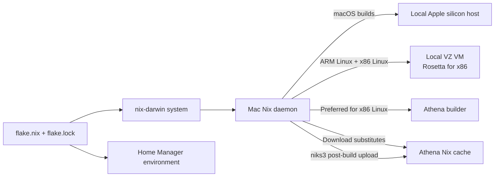

# Jason’s Mac, in Nix

[](https://github.com/jasonmc/nix-darwin/actions/workflows/darwin.yml)

The declarative setup for `Jasons-MacBook-Pro`: macOS settings, applications, development tools, shell configuration, and Linux builders, pinned together by one flake lockfile.

[nix-darwin](https://github.com/nix-darwin/nix-darwin) manages the system. [Home Manager](https://github.com/nix-community/home-manager) manages Jason’s user environment. Both share the same `nixpkgs-unstable` package set.

## What’s inside

- **Desktop:** Dock and Finder preferences, JetBrains Mono and Noto fonts, Ghostty, WezTerm, Emacs, and other applications.
- **Terminal:** Fish, Starship, fzf, zoxide, tmux, and a collection of search, navigation, and diagnostic tools.
- **Development:** Rust, Haskell, .NET, Nix tooling, and the `fixepub` overlay.
- **Linux builds:** a local Virtualization.framework VM and the remote Athena builder.
- **Caching:** downloads from Athena’s signed Nix cache and automatic uploads through niks3, with an agenix-managed token.

Homebrew is disabled. Home Manager copies macOS app bundles rather than linking them. Automatic Nix garbage collection removes generations older than 14 days; store optimisation runs separately.

## How builds fit together



The local builder uses upstream `pkgs.darwin.linux-builder-vz`. It runs an ARM NixOS guest, executes ARM Linux builds natively, and uses Rosetta for x86 Linux binaries. nix-darwin registers its SSH credentials and starts it as `org.nixos.linux-builder`.

| Builder | Systems | Concurrent jobs | Relative priority |
| --- | --- | ---: | ---: |
| `linux-builder` | `aarch64-linux`, `x86_64-linux` | 2 | 1 |
| `athenabuilder` → `athena.fibo` | `x86_64-linux` | 8 | 10 |

The local VM is configured with **8 CPUs, 6 GiB RAM, and a 100 GiB disk capacity**. It stays running in the background. Its two-job limit is separate from its CPU allocation. Nested virtualization is disabled, so it does not advertise KVM support; Athena handles builds requiring those features.

## Build and apply

This is a personal configuration for **Apple silicon running macOS 13 or newer**, with the user `jason` and home directory `/Users/jason`. A new machine also needs Nix with flakes enabled, Rosetta, and the machine-specific credentials described below.

Run these commands from the repository directory.

```sh
# Build without changing the running system
nix build '.#darwinConfigurations.Jasons-MacBook-Pro.system'

# Apply the system and Home Manager configuration
sudo darwin-rebuild switch --flake .#Jasons-MacBook-Pro
```

If `darwin-rebuild` is not installed yet, use the version pinned by this flake:

```sh
sudo nix run --inputs-from . nix-darwin#darwin-rebuild -- \
  switch --flake .#Jasons-MacBook-Pro
```

The initial activation needs administrator privileges. Rosetta must already be installed for the VZ guest’s x86 support:

```sh
softwareupdate --install-rosetta --agree-to-license
```

New Nix modules must be tracked by Git before a Git-backed flake can see them.

## Updating the environment

```sh
# Update every flake input, or just one
nix flake update
nix flake update nixpkgs

# Review, format, and validate before switching
git diff -- flake.lock
nix fmt
nix flake check --no-build
nix build --dry-run '.#darwinConfigurations.Jasons-MacBook-Pro.system'
```

`flake.lock` pins source revisions; updating it can change packages, dependencies, and generated configuration even when the local modules stay the same. A lockfile update does not change the running system until activation.

Keep `system.stateVersion` and `home.stateVersion` stable during routine updates: they control compatibility defaults, rather than package versions.

The installed `sync-flake-lock-from-darwin` helper copies **only the `nixpkgs` lock node** from the repository snapshot used to build it into another flake:

```sh
sync-flake-lock-from-darwin /path/to/another/flake
```

It uses the installed snapshot, so switch after updating this repository before using the helper to propagate the new pin.

## Checking the Linux builder

```sh
sudo launchctl print system/org.nixos.linux-builder
sudo ssh linux-builder 'uname -m; nix --version'

# VM diagnostics
/usr/bin/log show --last 10m \
  --predicate 'subsystem == "systems.applicative.vzvm"'
```

To test actual ARM compilation rather than a cached download, give `hello` a distinct derivation name and disable local builds:

```sh
nix build --impure --no-link --max-jobs 0 -L --expr '
  let
    flake = builtins.getFlake (toString ./.);
  in
    flake.inputs.nixpkgs.legacyPackages.aarch64-linux.hello.overrideAttrs (_: {
      pname = "hello-vz-smoke-test";
    })
'
```

The log should name `ssh-ng://builder@linux-builder`. Subsequent runs can reuse the test output; change its name to force another build. Avoid `--rebuild` for this test: it skipped remote dispatch with the Nix version used during setup.

## Credentials and the private cache

[modules/niks3.nix](modules/niks3.nix) configures `http://athena.fibo:5751` as a substituter and trusts its signing key. The niks3 post-build hook uploads build outputs there.

The API token is committed only as an encrypted age file. During activation, agenix decrypts it using `age-plugin-se` and the system identity at `/var/lib/agenix/niks3-system-se-identity.txt`; the decrypted token is root-owned with mode `0400`. Provision that identity and its matching Secure Enclave key before activating on a new Mac.

Athena builds also depend on network access to `athena.fibo` and SSH authentication. The SSH configuration points to the Secretive agent socket. These machine-specific dependencies are configured here; the repository does not provision the remote server or the Secure Enclave identity.

## Repository map

| File | Purpose |
| --- | --- |
| [flake.nix](flake.nix) | Inputs, overlays, and the `Jasons-MacBook-Pro` output |
| [flake.lock](flake.lock) | Exact dependency revisions |
| [darwin.nix](darwin.nix) | macOS preferences, Nix services, fonts, and system configuration |
| [packages.nix](packages.nix) | Machine-wide packages |
| [home.nix](home.nix) | User packages, shell, editor, Git, SSH, and terminal settings |
| [starship.toml](starship.toml) | Prompt configuration |
| [modules/build-machines.nix](modules/build-machines.nix) | VZ guest resources and Athena build routing |
| [modules/niks3.nix](modules/niks3.nix) | Cache access, uploads, and token decryption |
| [modules/sync-flake-lock-from-darwin.nix](modules/sync-flake-lock-from-darwin.nix) | Helper for sharing the pinned nixpkgs revision |
| [secrets/secrets.nix](secrets/secrets.nix) | age recipient declarations |
| [.github/workflows/darwin.yml](.github/workflows/darwin.yml) | macOS build workflow |

## Continuous integration

GitHub Actions builds the same `Jasons-MacBook-Pro` system output on pushes to `master` and manual dispatches. It installs Nix, enables Magic Nix Cache, and builds without activating the system or starting the VM.

The Linux guest closure must be available from a cache on a fresh macOS runner. Changing the guest’s NixOS configuration or resources can change that closure, so cache availability matters when updating the builder. CI checks the build; it does not verify secrets decryption, private-network access, or live Linux builds.
